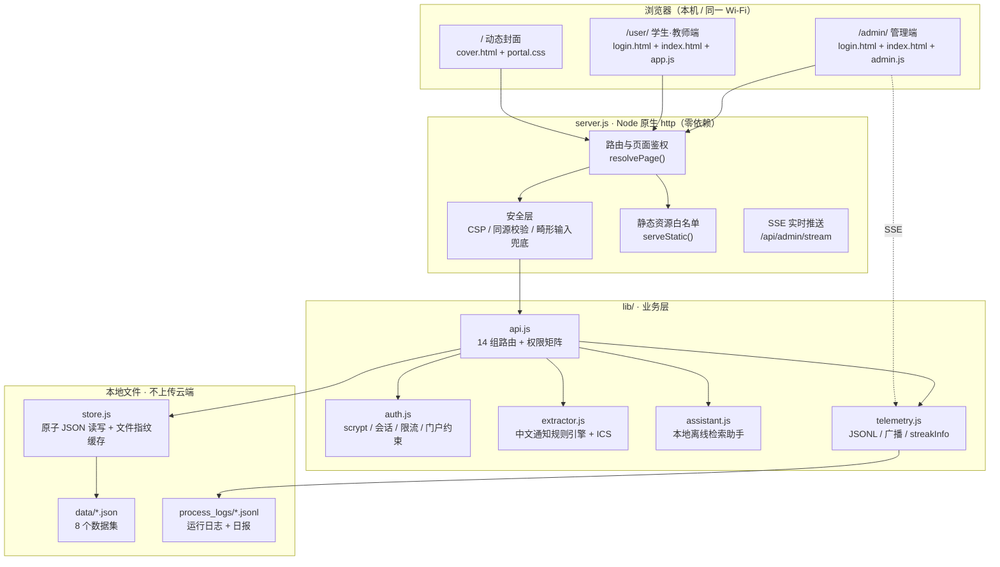
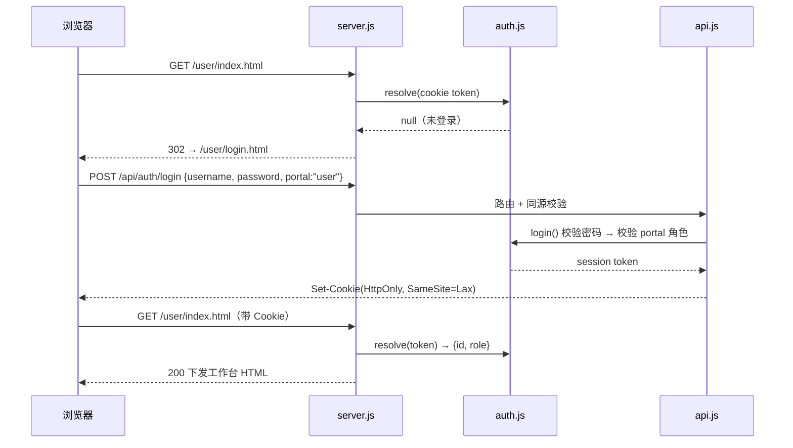
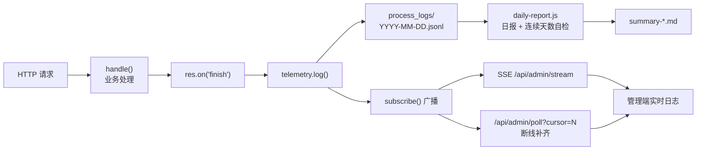

# 系统架构设计说明 · CampusDesk v6.2.0

> 对应 SRS 第 7 章「技术架构」与第 10 章交付物「系统架构图」。本文描述**本仓库实际运行的代码结构**，不是规划稿；与 SRS 规划栈的差异在文末单独列出。

---

## 1. 总体架构

**分层原则**：传输层（`server.js`）不写业务规则，业务路由（`lib/api.js`）不直接碰文件系统，数据访问统一走 `lib/store.js`，运行监控统一走 `lib/telemetry.js`。AI/助手能力封装在 `lib/assistant.js` 与 `lib/extractor.js`，可整体替换而不影响业务数据流。

---

## 2. 各层职责

| 层 | 文件 | 职责 | 关键约束 |
| --- | --- | --- | --- |
| 传输层 | `server.js` | HTTP 监听、端口自动顺延、URL/Cookie 安全解码、静态资源白名单、页面级鉴权、请求体 1 MB 上限、写请求同源校验、SSE 流、安全响应头、请求级 telemetry 收尾 | URL 解码与 Cookie 解析在 `try` 内；全局 `unhandledRejection` 兜底；5xx 不回传内部路径 |
| 业务路由 | `lib/api.js` | 14 组路由（`auth` / `bootstrap` / `dashboard` / `notice` / `equipment` / `loan` / `mistake` / `feedback` / `assistant` / `activity` / `logs` / `health` / `admin`）、角色权限矩阵 `PERMISSIONS`、归属过滤 `scoped()`、业务审计 `writeAudit()`、备份导出与恢复 | 除 `health` / `auth` 外全部要求有效会话；主键一律服务端生成 |
| 认证 | `lib/auth.js` | scrypt 加盐哈希、`HttpOnly + SameSite=Lax` Cookie、会话 token 哈希、登录失败限流、`portal` 入口角色约束 | 密码不可逆；账号不存在时做等价哈希避免时序枚举；首次管理员限本机 |
| 数据访问 | `lib/store.js` | 8 个数据集的读写、`writeFileSync(tmp)` + `renameSync` 原子写入、文件指纹（`mtimeMs:size:ino`）缓存失效 | 支持 `CAMPUSDESK_DATA_DIR` 隔离测试目录；账号/会话/审计不计入「业务数据是否为空」 |
| 规则引擎 | `lib/extractor.js` | 中文通知字段抽取、分类与重要程度、置信度、`.ics` 生成与 `VALARM` 提醒 | `extract_engine: 'local-rules'`，确定性、离线、无外部调用 |
| 离线助手 | `lib/assistant.js` | 自然语言意图识别 → 检索通知/待办/器材/逾期/错题 → 附 `sources` 来源 → 资料不足明确拒答 | 只读、零依赖、不联网、无 API Key；学生数据隔离；问题原文不落盘 |
| 监控 | `lib/telemetry.js` | JSONL 按自然日落盘、脱敏、SSE 广播、`by_error_code` / `by_role` / `by_source` 聚合、`streakInfo()` 连续天数自检 | 不写通知原文、姓名、题目、反馈正文；`source` 区分 `live` / `smoke` / `legacy` |

---

## 3. 三套入口与鉴权链路

- HTML **必须**经 `resolvePage()` 鉴权后才下发；静态资源走白名单，大小写变体不能绕过页面级检查。
- 旧链接 `/login.html` `/index.html` `/admin.html` 302 到对应新入口。
- 管理员账号从用户端登录、学生/教师从管理端登录均被拒（`PORTAL_MISMATCH`）；校验在密码验证通过之后，避免账号角色枚举。

---

## 4. 运行监控与数据流

每条记录含：`ts` / `day` / `app_version` / `source` / `session`（脱敏）/ `role` / `module` / `action` / `status` / `duration_ms` / `error_code` / `meta`。管理端可导出 JSON / CSV。

---

## 5. 部署形态

| 形态 | 启动命令 | 监听 | 适用 |
| --- | --- | --- | --- |
| 仅本机 | `node server.js` | `127.0.0.1:5173`（占用自动顺延） | 日常单人使用、开发调试 |
| 局域网 | `node server.js --lan --port 5174` | `0.0.0.0:5174`（所有网卡） | 手机 / 同学电脑在同一 Wi-Fi 试用，用于收集真实反馈 |

`--help` 查看全部参数；命令行优先级高于环境变量。局域网模式下「首次创建管理员」被限制为只能在本机完成，防止同网段抢注。数据始终留在本机 `data/`，不上传任何云端服务。

---

## 6. 安全边界

| 风险 | 措施 |
| --- | --- |
| 跨站写请求 | `Origin` / `Referer` 与 `Host` 同源校验，写请求（POST/PUT/DELETE）不一致即 403 |
| 脚本注入 | CSP `script-src 'self'`；前端渲染统一 `esc()` / `textContent` |
| 畸形输入打挂进程 | URL 解码、Cookie 解析移入 `try`；全局 `unhandledRejection` 兜底；畸形 URL 返回 400 且服务存活 |
| 信息外泄 | 5xx 返回固定提示，明细只写服务端控制台；日志脱敏 |
| 越权 | 服务端权限矩阵 + `scoped()` 归属过滤 + `assertOwner()`（无归属即拒绝）；主键服务端生成 |
| 数据丢失 | JSON 原子写入 + 文件指纹缓存失效；SHA256 备份校验 + 显式确认恢复；恢复不覆盖账号与会话 |
| 点击劫持 / MIME | `Referrer-Policy: same-origin`、`X-Content-Type-Options: nosniff`（frame 限制为兼容本地预览面板移除） |

> 局域网为明文 HTTP，密码在网段内不加密，**不应在公共 Wi-Fi 或校园大网开放**。

---

## 7. 与 SRS 规划技术栈的差异

| 层 | SRS 第 7 章规划 | 本仓库实际 | 差异性质 |
| --- | --- | --- | --- |
| 前端 | React + TypeScript + Vite + Tailwind + Electron | 原生 HTML/CSS/JS，三套入口 | **第一阶段简化**：换桌面壳会引入构建链与依赖，当前优先保证「零依赖即跑」与真实日志可采集 |
| 后端 | Python + FastAPI + SQLAlchemy + Alembic + Pydantic | Node.js 原生 `http` + 自研路由 | 同上；分层与接口约束等价保留 |
| 数据 | SQLite + 本地文件 | JSON 原子文件 + JSONL | **未迁移**，见 `docs/数据库设计说明.md` |
| AI | Ollama + 本地 LLM + OCR + RAG | 本地规则引擎 + 离线检索助手 | **未接入模型**；SRS 4.2 要求「AI 不可用时基础业务仍可用」，当前基础业务 100% 不依赖 AI |
| 工程 | pytest / Playwright | 自研 `scripts/smoke-test.js`（132 项） | 测试与日志能力等价，工具链不同 |

> 设计取舍：SRS 是完整型桌面应用的最终形态；本仓库是**第一阶段可运行版本**，用最小依赖把「真实可用 + 可持续运行 + 可追踪 + 可维护」四件事先落地，并把每次基于日志的迭代保留为可核对的 Git Diff。迁移到 SRS 技术栈时，替换 `lib/store.js` 与前端壳即可，业务路由与 telemetry 不必重写。
